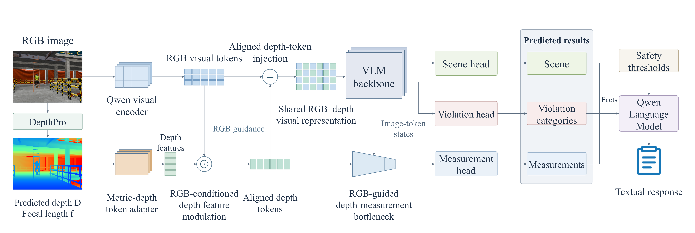
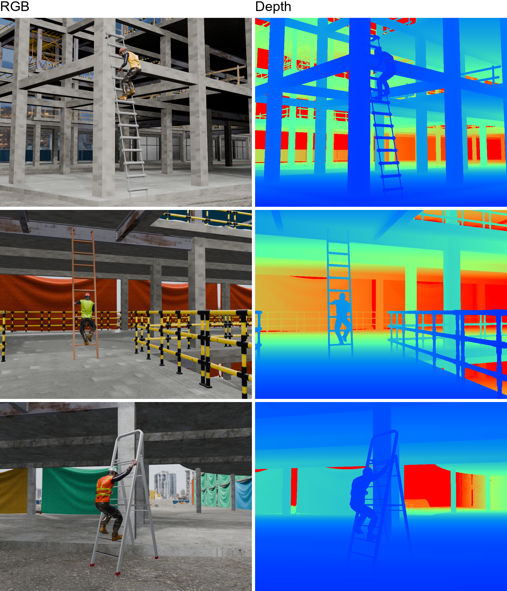

<div align="center">

# MetriVLM

### Depth-Aware Vision-Language Measurement with RGB Guidance for Construction Safety

Luxuan Fu · Weizheng Wang · Chong Liu · Bisheng Yang · Jichao Yang

[Overview](#overview) · [Core components](#core-components) · [Results](#results) · [Getting started](#getting-started) · [Data & contact](#data-availability)

</div>

---

## Overview

Construction safety assessment often depends on physical dimensions that are difficult to infer from appearance alone. **MetriVLM combines RGB localization with predicted metric depth** to estimate dimensions and support assessment against numerical safety rules.



The model aligns depth with RGB tokens, adapts depth features to local visual context, and aggregates measurement evidence through an RGB-guided bottleneck. It predicts scenes, physical measurements, and violation categories; compliance is derived from predicted measurements and safety thresholds.

## Core components

| Component | Role |
|:--|:--|
| **Metric-depth token adapter** | Encodes predicted metric depth, validity support, and focal-length features into aligned depth tokens. |
| **RGB-conditioned depth feature modulation** | Uses local RGB context to modulate depth features before projection and token injection. |
| **RGB-guided depth-measurement bottleneck** | Selects image locations and aggregates retained depth evidence for measurement contexts. |

The RGB and depth branches use independent measurement queries and attention weights. Their measurement contexts are combined by additive fusion.

## Paired RGB and depth examples



Paired RGB images and their corresponding depth visualizations from the manuscript. Each row shows one synthetic sample. The dataset pairs RGB images with depth maps, physical measurements, and violation labels derived from safety rules.

## Results

Reported results from the manuscript:

| Evaluation | MAE ↓ (cm) | RMSE ↓ (cm) |
|:--|--:|--:|
| Synthetic evaluation | **6.3797** | **10.0157** |
| 500 real photographs | **18.00** | **19.72** |

The real photographs were taken with handheld smartphones, with reference dimensions measured using a steel ruler. MetriVLM outperforms the RGB-only baseline across the reported evaluation settings.

## Getting started

This compact release provides **selected core components** and a tensor-level example. It covers depth preprocessing, token adaptation, RGB modulation, dual-branch measurement attention, and additive context fusion. The full Qwen integration, task heads, training pipeline, pretrained checkpoints, and datasets are outside this release.

```bash
python -m pip install -r requirements.txt
python demo_components.py
```

The example runs on CPU with random tensors and checks tensor shapes, validity handling, attention, fusion, and gradient flow. It does not run image-based inference or reproduce the reported accuracy.

```text
MetriVLM/
├── README.md
├── metrivlm.py               # Selected model components
├── demo_components.py        # CPU tensor-level example
├── requirements.txt
├── architecture.png
└── synthetic_examples.jpg
```

## Data availability

For dataset access and research enquiries, please contact **Luxuan Fu** at **[flxuan@whu.edu.cn](mailto:flxuan@whu.edu.cn)**.
